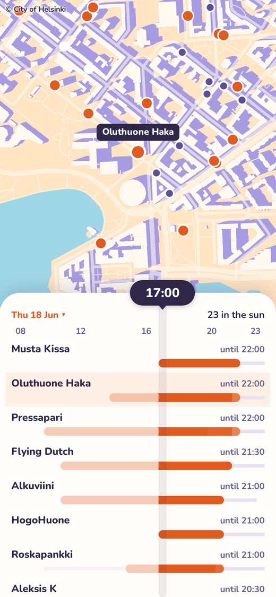
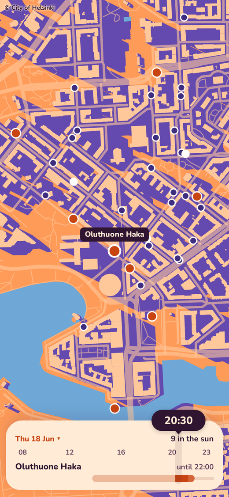
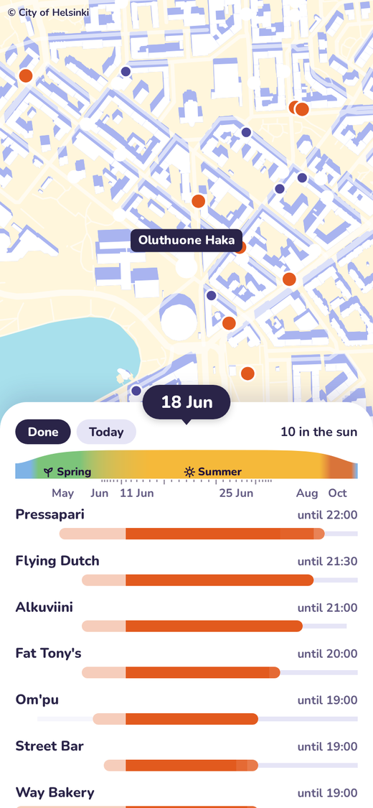
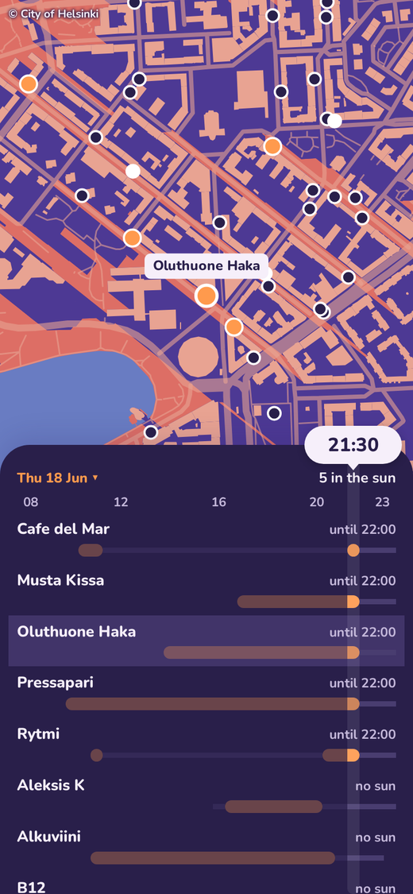

# Terracer

Which bar terraces in Kallio are in the sun, and for how long? Pick a date and time, and Terracer draws the shadows on a map. For each of the 43 bars, a strip shows when the terrace gets sun while the bar is open.

<table>
  <tr>
    <td></td>
    <td></td>
    <td></td>
    <td></td>
  </tr>
</table>

The sun and shade are computed ahead of time by casting rays from each terrace towards the sun through the City of Helsinki's 3D mesh, every half hour on 27 dates through the year. The 3D model, building footprints, streets, water and terrace permits are open data from the City of Helsinki (CC BY 4.0). The computed data is in the repo, so `pixi install` and `pixi run app` are enough to run it.
